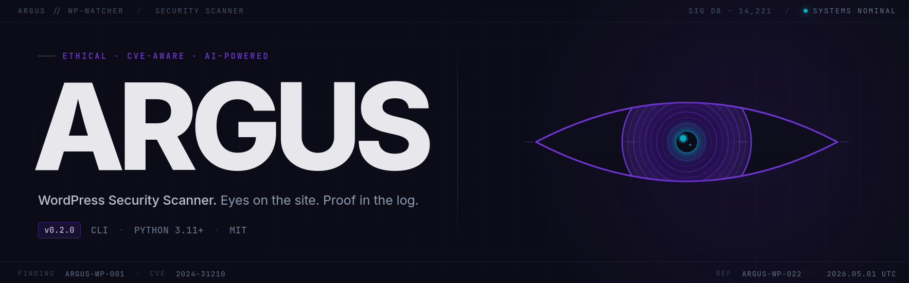
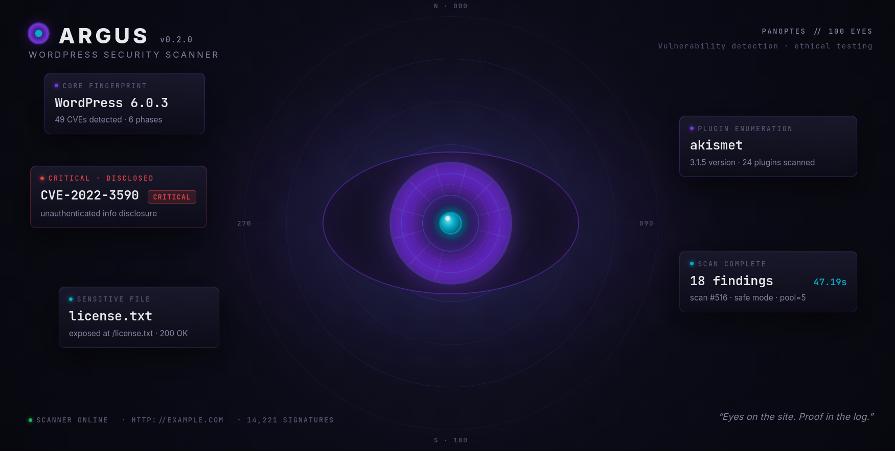
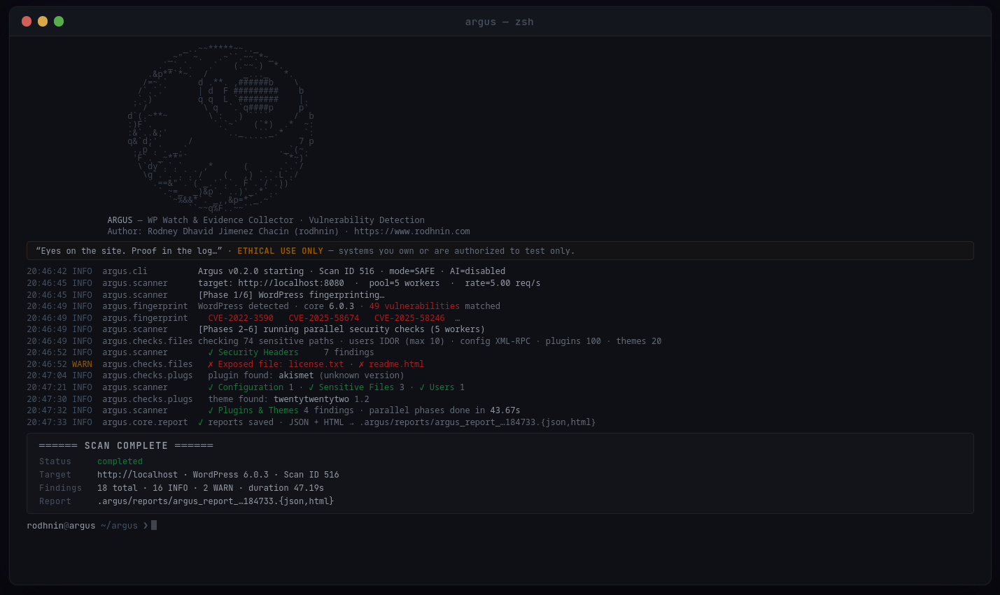
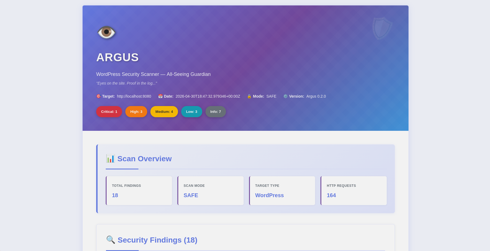
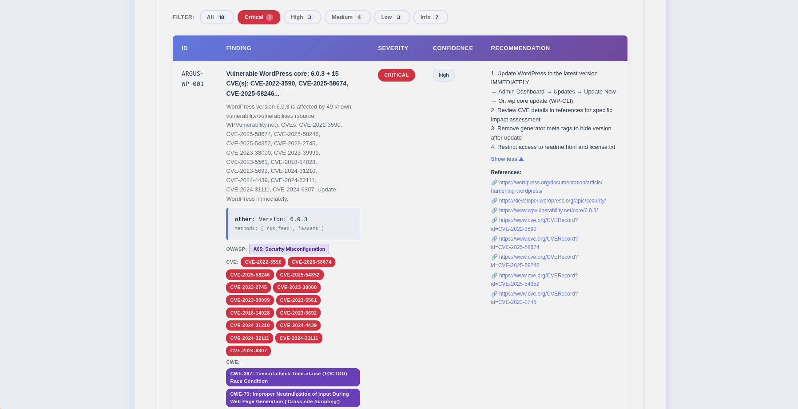

<div align="center">
  
</div>

<br>

<div align="center">

[](https://github.com/rodhnin/argus-wp-watcher/releases)
[](https://www.python.org/)
[](LICENSE)
[](docker/)
[](docs/AI_INTEGRATION.md)
[](docs/ETHICS.md)

<br>

**Ethical WordPress vulnerability scanner — real-time CVE correlation, OWASP mapping, AI-powered analysis, and consent-based testing.**

<br>

[Quick Start](#-quick-start) &nbsp;·&nbsp;
[Documentation](docs/) &nbsp;·&nbsp;
[Docker](#-docker-deployment) &nbsp;·&nbsp;
[AI Features](#-ai-powered-analysis) &nbsp;·&nbsp;
[Star on GitHub](https://github.com/rodhnin/argus-wp-watcher)

</div>

<br>

<div align="center">
  
</div>

---

## In Action

<div align="center">
  
  <br><sub>Live scan · WordPress 6.0.3 · 49 CVEs detected · 18 findings · 47s</sub>
</div>

<br>

<table width="100%"><tr>
<td width="50%" align="center">
  
  <br><sub>Scan overview · severity breakdown</sub>
</td>
<td width="50%" align="center">
  
  <br><sub>Findings · CVE/OWASP badges · filter bar</sub>
</td>
</tr></table>

---

## 🎯 What is Argus?

Argus is a production-ready WordPress security scanner that puts **ethics first**. Built for penetration testers, security researchers, and WordPress administrators, it combines traditional vulnerability scanning with cutting-edge AI analysis to deliver actionable insights.

### Why Argus?

- **🔒 Ethical by Design**: Consent token system prevents unauthorized scanning
- **🔍 Real CVE Data**: Live correlation with WPVulnerability.net + CVSS scores from NVD (both free, no key)
- **🗂️ OWASP Mapping**: Every finding mapped to OWASP Top 10 2021
- **📈 Scan Diffing**: `--diff last` compares scans to track remediation progress
- **🤖 AI-Powered**: GPT-4, Claude, or local Ollama — with streaming, agent mode, and multi-LLM compare
- **📊 Professional Reports**: Rich HTML with CVE/CWE/OWASP/CVSS badges + machine-readable JSON
- **🚀 Fast & Efficient**: Concurrent scanning with intelligent rate limiting
- **💾 Persistent Tracking**: SQLite database for scan history
- **🐳 Docker Ready**: Containerized scanning + vulnerable test lab included

### What It Scans

| Check Category          | Safe Mode   | Aggressive  | Details                                                                  |
| ----------------------- | ----------- | ----------- | ------------------------------------------------------------------------ |
| **WordPress Detection** | ✅          | ✅          | Version fingerprinting via meta tags, readme, RSS, assets                |
| **Plugins & Themes**    | 100 plugins | 447 plugins | Version detection (4 methods) + real-time CVE/CVSS correlation           |
| **Sensitive Files**     | 74 paths    | 437 paths   | wp-config backups, .env, SQL dumps, .git, debug logs, PHP tools          |
| **User Enumeration**    | 3 methods   | 6 methods   | Author IDOR, REST API, HTML parsing + oEmbed, login error, XML-RPC       |
| **Security Headers**    | ✅          | ✅          | HSTS, CSP, X-Frame-Options, Referrer-Policy, Permissions-Policy          |
| **Misconfigurations**   | ✅          | ✅          | XML-RPC, debug mode, directory listing, file editor                      |
| **Login Security**      | ❌          | ✅          | 2FA, CAPTCHA, brute-force protection, open registration, password policy |
| **Web Crawl**           | ❌          | ✅          | robots.txt, sitemap.xml, HTML comments, link discovery (depth 1)         |

---

## ✨ Features

### 🛡️ Core Security Scanning

```bash
# One command, comprehensive analysis
python -m argus --target https://example.com --html
```

- **Multi-Method Fingerprinting**: Detects WordPress 4.x-6.x with zero false positives
- **Real-Time CVE Correlation**: Checks every detected plugin, theme, and core version against WPVulnerability.net (free, no API key)
- **CVSS Scoring**: Fetches scores from NVD for each CVE (critical ≥9.0, high ≥7.0, medium ≥4.0)
- **Latest Version Detection**: WordPress.org API shows the current stable version alongside detected version
- **OWASP Top 10 2021**: Every finding mapped to its OWASP category (A01–A10)
- **Concurrent Scanning**: Thread pool + rate limiting for fast, respectful scans
- **Smart Detection**: Early abort for non-WordPress sites (99% faster rejection)
- **Evidence Collection**: HTTP responses, headers, and file contents preserved

### 📈 Scan Diff Reports (v0.2.0)

Track remediation progress between scans:

```bash
# Compare this scan against the previous one
python -m argus --target https://example.com --html --diff last

# Or reference a specific scan ID
python -m argus --target https://example.com --html --diff 42
```

The diff section shows:

- **New** findings (appeared since last scan) — in red
- **Fixed** findings (remediated since last scan) — in green with strikethrough
- **Persisting** findings (present in both scans) — collapsed by default
- **Mode mismatch warning** when comparing safe vs aggressive scans

### 🤖 AI-Powered Analysis

Choose your AI provider based on your needs:

| Provider                         | Best For           | Speed     | Cost/scan  | Privacy         |
| -------------------------------- | ------------------ | --------- | ---------- | --------------- |
| **OpenAI gpt-4o-mini** (default) | Best value         | ⚡ ~40s   | 💰 ~$0.006 | 🔒 Standard     |
| **OpenAI gpt-4o**                | Production quality | ⚡ ~40s   | 💰 ~$0.05  | 🔒 Standard     |
| **Anthropic claude-3-5-haiku**   | Privacy-focused    | ⚡ ~55s   | 💰 ~$0.02  | 🔒 Enhanced     |
| **Ollama (Local)**               | Complete privacy   | 🐢 ~28min | 💰 Free    | 🔐 100% Offline |

**Analysis Modes:**

- **Technical**: Step-by-step remediation with WP-CLI commands and configuration snippets
- **Executive**: Plain-language summaries for stakeholders and management
- **Agent** (`--ai-agent`): Enriched with live NVD CVE data and WPVulnerability.net lookups (free APIs)
- **Compare** (`--ai-compare`): Side-by-side analysis from multiple providers in parallel
- **Stream** (`--ai-stream`): Real-time token output as the AI generates
- **Budget** (`--ai-budget`): Cost cap enforcement with configurable abort threshold

### 📊 Professional Reporting

**JSON Reports** (Machine-Readable)

```json
{
  "tool": "argus",
  "version": "0.2.0",
  "target": "https://example.com",
  "summary": {"critical": 3, "high": 5, "medium": 8, "low": 6, "info": 5},
  "findings": [
    {
      "id": "ARGUS-WP-012",
      "title": "Vulnerable plugin: elementor v3.5.0 (31 CVEs)",
      "severity": "critical",
      "owasp": {"id": "A06", "name": "Vulnerable and Outdated Components"},
      "latest_version": "3.28.1",
      "cve": ["CVE-2022-1329", "CVE-2022-29455"],
      "vulnerabilities": [
        {"title": "Elementor < 3.4.8 — Authenticated RCE", "cvss": 8.8, "cve_id": "CVE-2022-1329"}
      ]
    }
  ],
  "diff": {"ref_scan_id": 41, "new": [...], "fixed": [...], "persisting": [...]}
}
```

**HTML Reports** (Human-Friendly, v0.2.0)

- 🎨 Responsive design with inline CSS (no external dependencies)
- 🏷️ Color-coded severity badges + interactive filter bar
- 🔴 CVE badges linking to NVD, purple CWE badges (deduplicated)
- 🟣 OWASP Top 10 2021 badge per finding
- 🟢 Latest stable version badge for vulnerable components
- 📊 Color-coded CVSS score badge per CVE (red/orange/yellow/green)
- 📝 Expandable CVE detail panels, expandable recommendations
- 🔧 Security header config snippets (Apache / Nginx / WordPress)
- 📈 Diff section (new/fixed/persisting) with mode mismatch warning
- 🤖 AI analysis with tabs (executive / technical / agent)
- 📱 Mobile-friendly

### 🔐 Consent Token System

Argus enforces ethical hacking through technology. Aggressive scanning and AI analysis require **proof of ownership**:

```bash
# 1. Generate token
python -m argus --gen-consent example.com

# 2. Place token on your server
echo "verify-abc123..." > .well-known/verify-abc123.txt

# 3. Verify ownership
python -m argus --verify-consent http --domain example.com --token verify-abc123

# 4. Now you can use aggressive mode
python -m argus --target https://example.com --aggressive --use-ai
```

### 💾 Database Persistence

SQLite database tracks everything:

- **Scan History**: Date, duration, findings count, severity breakdown
- **Finding Repository**: Searchable vulnerability database with `finding_code` index
- **Verified Domains**: Consent token tracking with expiration
- **AI Cost Records**: Per-analysis cost tracking with `ai_costs` table (v0.2.0+)
- **Diff Foundation**: Findings persisted per scan enable `--diff` comparisons

```bash
# Query recent scans
sqlite3 ~/.argos/argos.db "SELECT * FROM v_recent_scans LIMIT 10"

# Find critical issues
sqlite3 ~/.argos/argos.db "SELECT * FROM v_critical_findings"
```

---

## 🚀 Quick Start

### Prerequisites

- **Python 3.11+** (3.12 recommended)
- **pip** (Python package manager)
- **Docker** (optional, for containerized scanning)

### Installation

**1. Clone the repository**

```bash
git clone https://github.com/rodhnin/argus-wp-watcher.git
cd argus-wp-watcher
```

**2. (Optional) Install `venv` if not already available**

```bash
# Debian/Ubuntu
sudo apt update && sudo apt install -y python3-venv

# Fedora/RHEL
sudo dnf install python3-virtualenv

# macOS (via Homebrew)
brew install python@3.11
```

**3. Create and activate virtual environment**

```bash
python3 -m venv .venv
source .venv/bin/activate
# You should see (.venv) in your terminal prompt
```

**4. Upgrade pip**

```bash
python -m pip install --upgrade pip
```

**5. Install dependencies**

```bash
python -m pip install -r requirements.txt
```

**6. Configure API keys (if using cloud AI)**

```bash
# OpenAI
export OPENAI_API_KEY="sk-..."

# Anthropic
export ANTHROPIC_API_KEY="sk-ant-..."
```

**7. Verify installation**

```bash
python -m argus --version
# Output: Argus v0.2.0
```

### Your First Scan

```bash
# Basic scan (safe mode, no consent required)
python -m argus --target https://example.com

# With HTML report
python -m argus --target https://example.com --html

# With AI analysis (requires consent token)
python -m argus --target https://example.com --use-ai --html
```

**🎉 Success!** Check `~/.argos/reports/` for your reports.

---

## 📘 Usage Guide

### Basic Scanning

```bash
# Safe mode (default) - Non-intrusive checks
python -m argus --target https://example.com

# Generate HTML report
python -m argus --target https://example.com --html

# Increase verbosity for debugging
python -m argus --target https://example.com -vv
```

### Advanced Scanning

```bash
# Control scan speed (1-20 req/s)
python -m argus --target https://example.com --rate 10

# Control concurrency (1-20 threads)
python -m argus --target https://example.com --threads 8

# Custom timeout
python -m argus --target https://example.com --timeout 60

# Custom output directory
python -m argus --target https://example.com --report-dir ./my-reports
```

### AI-Powered Analysis

**Step 1: Set your API key**

```bash
export OPENAI_API_KEY="sk-..."
```

**Step 2: Test your setup**

```bash
# Verify AI works with default model (gpt-4o-mini-2024-07-18)
python -m argus.core.ai openai
```

**Step 3: Run AI-powered scan**

```bash
# Both analyses in one scan (~$0.006 with default model)
python -m argus --target https://example.com --use-ai --html

# Technical only (for security teams)
python -m argus --target https://example.com --use-ai --ai-tone technical --html

# Executive only (for management)
python -m argus --target https://example.com --use-ai --ai-tone non_technical --html

# Override model or provider at runtime
python -m argus --target https://example.com --use-ai --ai-model gpt-4o --html
python -m argus --target https://example.com --use-ai --ai-provider anthropic --html

# Stream output in real time
python -m argus --target https://example.com --use-ai --ai-stream

# Agent mode with NVD CVE lookup (free)
python -m argus --target https://example.com --use-ai --ai-agent --html

# Compare two providers side by side
python -m argus --target https://example.com \
  --use-ai --ai-compare openai,anthropic --html

# Budget cap ($0.05 max)
python -m argus --target https://example.com --use-ai --ai-budget 0.05
```

### Aggressive Mode (Requires Consent)

```bash
# Step 1: Generate consent token
python -m argus --gen-consent example.com
# Output: Token: verify-a3f9b2c1d8e4...

# Step 2: Place token on your server
# Create: https://example.com/.well-known/verify-a3f9b2c1d8e4.txt
# Content: verify-a3f9b2c1d8e4

# Step 3: Verify consent
python -m argus --verify-consent http \
  --domain example.com \
  --token verify-a3f9b2c1d8e4

# Step 4: Run aggressive scan
python -m argus --target https://example.com --aggressive
```

---

## 🤖 AI-Powered Analysis

Argus uses **LangChain 1.0.0** with support for multiple AI providers, giving you flexibility based on your security, privacy, and budget requirements.

### Supported Providers

#### OpenAI GPT-4 Turbo

**Best for: Production use**

- ⭐ Quality: Excellent (5/5)
- ⚡ Speed: ~35 seconds
- 💰 Cost: ~$0.25 per scan
- 🔒 Privacy: Standard (data encrypted in transit)

```bash
export OPENAI_API_KEY="sk-..."
python -m pip install langchain-openai==1.0.0
```

#### Anthropic Claude

**Best for: Enhanced privacy**

- ⭐ Quality: Excellent (5/5)
- ⚡ Speed: ~45 seconds
- 💰 Cost: ~$0.30 per scan
- 🔒 Privacy: Enhanced (Anthropic's privacy-first approach)

```bash
export ANTHROPIC_API_KEY="sk-ant-..."
python -m pip install langchain-anthropic==1.0.0
```

#### Ollama (Local Models)

**Best for: Complete privacy**

- ⭐ Quality: Good (3/5)
- 🐢 Speed: ~28 minutes (CPU) or ~75 seconds (GPU)
- 💰 Cost: Free
- 🔐 Privacy: 100% offline (data never leaves your machine)

```bash
# Install Ollama: https://ollama.ai
ollama pull llama3.2
python -m pip install "langchain-ollama>=0.3.0,<0.4.0"
```

### Privacy & Security

**Automatic Sanitization**
Before sending data to AI providers, Argus automatically removes:

- ✅ Consent tokens
- ✅ API keys and credentials
- ✅ Personal Identifiable Information (PII)
- ✅ Internal IP addresses
- ✅ Database credentials

**Opt-In Only**

- AI analysis requires explicit `--use-ai` flag
- Aggressive scanning requires verified consent token
- You control which provider sees your data

**For Maximum Privacy**
Use Ollama locally. While slower and less accurate, your scan data never leaves your machine.

### Switching Providers

**Option A — CLI flags (runtime override, no file editing)**

```bash
# Switch to Anthropic for this scan only
python -m argus --target https://example.com --use-ai --ai-provider anthropic --ai-model claude-3-5-haiku-20241022

# Switch to local Ollama
python -m argus --target https://example.com --use-ai --ai-provider ollama --ai-model llama3.2
```

**Option B — `config/defaults.yaml` (change the persistent default)**

```yaml
ai:
    langchain:
        provider: "ollama" # Changed from "openai"
        model: "llama3.2" # Ollama model
        ollama_base_url: "http://localhost:11434"
```

**Coming in v0.3.0:** Interactive configuration menu (Metasploit-style)

```bash
# Future feature
argus --show-options
argus --set ai.provider=anthropic
argus --save-profile privacy-mode
```

---

## 🧪 Safe Testing Lab

**⚠️ NEVER scan production sites without written permission!**

Use our Docker lab to practice safely:

### Setup Test Environment

```bash
# Navigate to docker directory
cd docker

# Option 1: Use interactive script
./deploy.sh
# Select option 2 (Testing Lab)

# Option 2: Manual deployment
docker compose -f compose.testing.yml up -d

# Wait for services to start (~60-90 seconds)
docker compose -f compose.testing.yml logs -f wordpress

# Setup WordPress
# Open http://localhost:8080 in your browser
# Complete WordPress installation
# Username: admin
# Password: (choose a strong password)

# Create vulnerable conditions for testing
docker compose -f compose.testing.yml exec wordpress bash -c \
  "cp /var/www/html/wp-config.php /var/www/html/wp-config.php.bak"
```

### Scan the Lab

```bash
# Return to project root
cd ..

# Run scan against lab
python -m argus --target http://localhost:8080 --html

# Try AI analysis (requires API key)
python -m argus --target http://localhost:8080 --use-ai --html
```

### Cleanup

```bash
cd docker
docker compose -f compose.testing.yml down -v  # -v removes all data
```

For detailed testing scenarios, see [docs/TESTING_GUIDE.md](docs/TESTING_GUIDE.md)

---

## 🔒 Ethics & Legal

### The Golden Rule

**Only scan systems you own or have explicit written permission to test.**

### Consent Enforcement

Argus implements **technical controls** to prevent misuse:

| Mode            | Checks                 | Consent Required | Rate Limit |
| --------------- | ---------------------- | ---------------- | ---------- |
| **Safe**        | Non-intrusive          | ❌ No            | 5 req/s    |
| **Aggressive**  | Deep scanning          | ✅ Yes           | 10 req/s   |
| **AI Analysis** | Vulnerability analysis | ✅ Yes           | N/A        |

### Legal Framework

Unauthorized access to computer systems is **illegal** in most jurisdictions:

- 🇺🇸 **USA**: Computer Fraud and Abuse Act (CFAA)
- 🇬🇧 **UK**: Computer Misuse Act 1990
- 🇪🇺 **EU**: Directive 2013/40/EU
- 🌍 **International**: Various cybercrime laws

### Best Practices

1. ✅ **Get written authorization** before scanning
2. ✅ **Define scope clearly** (which domains/IPs)
3. ✅ **Document everything** (consent, findings, remediation)
4. ✅ **Use safe mode first** to establish baseline
5. ✅ **Report findings responsibly** (coordinated disclosure)
6. ❌ **Never exploit vulnerabilities** without explicit permission
7. ❌ **Never scan third-party sites** (e.g., wordpress.org, google.com)

For complete ethical guidelines, see [docs/ETHICS.md](docs/ETHICS.md)

---

## 🐳 Docker Deployment

Argus provides **three deployment modes** via an interactive script:

1. **Production**: Scanner only (for scanning external sites)
2. **Testing Lab**: Vulnerable WordPress only (for security testing)
3. **Both**: Production scanner + Testing lab together

### Quick Start (Recommended)

Use the interactive deployment script:

```bash
cd docker
./deploy.sh
```

**Menu options:**

- `1` → Production scanner only
- `2` → Testing lab (WordPress + MariaDB) only
- `3` → Both environments
- `4` → Stop all services
- `5` → Remove all containers and data (reset)

---

### Option 1: Production Scanner

Deploy just the Argus scanner for scanning external WordPress sites:

```bash
cd docker
./deploy.sh
# Select option 1
```

**Or manually:**

```bash
docker compose up -d
```

**Scan a target:**

```bash
docker compose exec argus python -m argus --target https://example.com
```

**With AI analysis:**

```bash
docker compose exec argus python -m argus --target https://example.com --use-ai
```

**Stop:**

```bash
docker compose down
```

---

### Option 2: Testing Lab (WordPress Only)

⚠️ **WARNING**: This environment is **INTENTIONALLY VULNERABLE** for testing purposes.
**DO NOT expose to public internet!**

**Deploy the testing lab:**

```bash
cd docker
./deploy.sh
# Select option 2
```

**Or manually:**

```bash
docker compose -f compose.testing.yml up -d
```

**What gets deployed:**

- ✅ MariaDB database (for WordPress)
- ✅ WordPress 6.0 (intentionally vulnerable)
- ❌ Argus scanner (NOT included in this mode)

**Access:**

- WordPress: http://localhost:8080 (bound to 127.0.0.1 only)
- Initial setup takes ~60-90 seconds

**Scan the test environment:**

```bash
# Scan from HOST (recommended)
python -m argus --target http://localhost:8080

# Note: Scanner container is NOT deployed in option 2
# To scan from container, use option 3 (Both)
```

**Stop and remove:**

```bash
docker compose -f compose.testing.yml down -v
```

---

### Option 3: Both Environments

Deploy production scanner + testing lab together:

```bash
cd docker
./deploy.sh
# Select option 3
```

**What gets deployed:**

- ✅ Production Argus scanner
- ✅ MariaDB database
- ✅ WordPress 6.0 (vulnerable)
- ✅ Connection between production scanner and testing network

**Scan external sites from production scanner:**

```bash
docker compose exec argus python -m argus --target https://example.com
```

**Scan the testing lab from production scanner:**

```bash
docker compose exec argus python -m argus --target http://wordpress
```

**Stop all:**

```bash
cd docker
./deploy.sh
# Select option 4
```

---

## 📊 Understanding Reports

### Report Structure

```
~/.argos/
├── reports/
│   ├── argus_report_example_20251020_143022.json  # Machine-readable
│   └── argus_report_example_20251020_143022.html  # Human-friendly
├── argos.db          # SQLite database
└── logs/
    └── argus.log     # Scan logs
```

### JSON Report Schema

```json
{
    "tool": "argus",
    "version": "0.2.0",
    "target": "https://example-wp-site.com",
    "date": "2026-04-15T18:45:30Z",
    "mode": "safe",
    "summary": {
        "critical": 1,
        "high": 2,
        "medium": 4,
        "low": 3,
        "info": 5
    },
    "findings": [
        {
            "id": "ARGUS-WP-012",
            "title": "Vulnerable plugin: contact-form-7 v5.3.1 (6 CVEs)",
            "severity": "critical",
            "confidence": "high",
            "owasp": { "id": "A06", "name": "Vulnerable and Outdated Components" },
            "latest_version": "5.9.8",
            "cve": ["CVE-2021-39346", "CVE-2020-35489"],
            "vulnerabilities": [
                {
                    "title": "Contact Form 7 < 5.3.2 — Unrestricted File Upload",
                    "cvss": 9.8,
                    "cve_id": "CVE-2020-35489",
                    "cwe": ["CWE-434"]
                }
            ],
            "description": "Plugin 'contact-form-7' v5.3.1 has 6 known CVEs. Highest CVSS: 9.8 (Critical).",
            "evidence": {
                "type": "path",
                "value": "https://example-wp-site.com/wp-content/plugins/contact-form-7/readme.txt",
                "context": "Version detected via readme.txt"
            },
            "recommendation": "Update contact-form-7 to 5.9.8 (latest stable). Immediate action required.",
            "affected_component": "contact-form-7 5.3.1"
        },
        {
            "id": "ARGUS-WP-030",
            "title": "wp-config.php backup exposed",
            "severity": "critical",
            "confidence": "high",
            "owasp": { "id": "A05", "name": "Security Misconfiguration" },
            "description": "WordPress configuration file backup is publicly accessible.",
            "evidence": {
                "type": "url",
                "value": "https://example-wp-site.com/wp-config.php.bak",
                "context": "HTTP 200, Size: 2847 bytes"
            },
            "recommendation": "Remove immediately and rotate all credentials.",
            "affected_component": "wp-config.php.bak"
        },
        {
            "id": "ARGUS-WP-050",
            "title": "Missing security header: HSTS",
            "severity": "medium",
            "confidence": "high",
            "owasp": { "id": "A02", "name": "Cryptographic Failures" },
            "description": "HSTS header is not set.",
            "evidence": {
                "type": "header",
                "value": "Strict-Transport-Security: [not set]",
                "context": "Header missing in HTTP response"
            },
            "recommendation": "Add: Strict-Transport-Security: max-age=31536000; includeSubDomains; preload"
        }
    ],
    "diff": {
        "ref_scan_id": 41,
        "ref_date": "2026-04-10T10:00:00Z",
        "ref_mode": "safe",
        "current_mode": "safe",
        "mode_mismatch": false,
        "new": [{ "id": "ARGUS-WP-012", "title": "Vulnerable plugin: contact-form-7...", "severity": "critical" }],
        "fixed": [],
        "persisting": [{ "id": "ARGUS-WP-050", "title": "Missing security header: HSTS", "severity": "medium" }]
    },
    "notes": {
        "scan_duration_seconds": 26.4,
        "requests_sent": 312,
        "rate_limit_applied": true,
        "scope_limitations": "Scan limited to publicly accessible pages.",
        "false_positive_disclaimer": "Manual verification recommended before remediation."
    }
}
```

> For the complete schema reference see [docs/REPORT_FORMAT.md](docs/REPORT_FORMAT.md) and [`schema/report.schema.json`](schema/report.schema.json).

### HTML Report Features (v0.2.0)

- **📊 Executive Dashboard**: Summary cards with severity counts + interactive filter bar
- **🟣 OWASP Top 10 2021 badge** per finding (links to owasp.org)
- **🔴 CVE badges** linking to NVD, with expandable detail panels
- **🟠 CVSS score badges** color-coded per CVE (Critical ≥9.0, High ≥7.0, Medium ≥4.0)
- **🟤 CWE badges** (deduplicated) per finding
- **🟢 Latest stable version badge** for outdated components
- **📈 Diff section**: new / fixed / persisting finding tables with mode mismatch warning
- **🤖 AI Analysis**: tabs for executive, technical, and agent analysis
- **🔧 Config snippets**: Apache / Nginx / WordPress hardening code blocks
- **📝 Expandable recommendations** and evidence sections
- **📱 Mobile-friendly** with inline CSS (no external dependencies)

---

## 📁 Project Structure

```
argus-wp-watcher/
│
├── argus/                      # Main application package
│   ├── checks/                 # Security check modules
│   │   ├── config.py           # Configuration auditing (XML-RPC, debug, editor)
│   │   ├── crawl.py            # Web crawl checks (robots, sitemap, comments) [v0.2.0]
│   │   ├── files.py            # Sensitive file detection (74 safe / 437 aggressive paths)
│   │   ├── fingerprint.py      # WordPress detection + CVE check for core
│   │   ├── headers.py          # Security headers analysis
│   │   ├── login.py            # Login security checks (2FA, CAPTCHA, brute-force) [v0.2.0]
│   │   ├── plugins.py          # Plugin/theme enumeration + CVE correlation [v0.2.0]
│   │   └── users.py            # User enumeration
│   │
│   ├── core/                   # Core infrastructure
│   │   ├── ai.py               # AI integration (LangChain, streaming, agent, compare)
│   │   ├── config.py           # Configuration management
│   │   ├── consent.py          # Consent token system
│   │   ├── db.py               # SQLite database interface
│   │   ├── diff.py             # Scan diff computation (new/fixed/persisting) [v0.2.0]
│   │   ├── http_client.py      # Rate-limited HTTP client
│   │   ├── logging.py          # Structured logging
│   │   ├── owasp.py            # OWASP Top 10 2021 mapping for all finding IDs [v0.2.0]
│   │   ├── report.py           # Report generation (JSON + HTML)
│   │   └── vuln_db.py          # CVE lookup (WPVulnerability.net + NVD) [v0.2.0]
│   │
│   ├── __main__.py             # Entry point
│   ├── cli.py                  # CLI argument parser
│   └── scanner.py              # Main scan orchestrator
│
├── config/                     # Configuration files
│   ├── defaults.yaml           # Default settings
│   └── prompts/                # AI prompt templates
│       ├── technical.txt       # Technical analysis prompt
│       └── non_technical.txt   # Executive summary prompt
│
├── db/
│   └── migrate.sql             # Database schema
│
├── assets/
│   └── ascii.txt               # ASCII art branding
│
├── docker/                     # Docker deployment
│   ├── compose.yml             # Production scanner compose
│   ├── compose.testing.yml     # Vulnerable WordPress lab
│   ├── deploy.sh               # Interactive deployment script
│   ├── setup-lab.sh            # Automated vulnerable lab setup [v0.2.0]
│   └── Dockerfile              # Production image
│
├── docs/                       # Documentation
│   ├── AI_INTEGRATION.md       # AI setup guide
│   ├── CONSENT.md              # Consent system details
│   ├── DATABASE_GUIDE.md       # Database reference
│   ├── ETHICS.md               # Ethical guidelines
│   ├── REPORT_FORMAT.md        # Report specification
│   ├── ROADMAP.md              # Development roadmap
│   └── TESTING_GUIDE.md        # Safe testing practices
│
├── schema/
│   └── report.schema.json      # JSON report schema
│
├── scripts/
│   └── cli-examples.md         # CLI usage examples
│
├── templates/
│   └── report.html.j2          # HTML report template
│
├── CHANGELOG.md                # Version history
├── LICENSE                     # MIT License
├── README.md                   # This file
├── requirements.txt            # Python dependencies
└── setup.py                    # Package installer
```

---

## 🗺️ Roadmap

### v0.1.0 — Initial Release ✅ (November 2025)

**Status:** 🎉 **Released**

- ✅ Complete WordPress security scanner (130+ checks)
- ✅ AI-powered analysis (OpenAI, Anthropic, Ollama)
- ✅ Consent token system (HTTP + DNS verification)
- ✅ Professional reporting (JSON + HTML)
- ✅ SQLite persistence and scan history
- ✅ Docker support with vulnerable lab
- ✅ Comprehensive error handling and resilience

### v0.2.0 — Enhanced Detection & AI ✅ (May 2026)

**Status:** 🎉 **Released**

- ✅ **Plugin Version Detection**: 4-method cascade (HTML ?ver=, readme.txt, changelog, PHP header)
- ✅ **Real-Time CVE Correlation**: WPVulnerability.net (free, no key) for plugins, themes, WP core
- ✅ **CVSS Scoring**: NVD API — color-coded critical/high/medium/low badges per CVE
- ✅ **Latest Version**: WordPress.org API shows current stable version alongside detected version
- ✅ **OWASP Top 10 2021 Mapping**: Every finding mapped to A01–A10 with badge in HTML report
- ✅ **Enhanced HTML Reports**: CVE/CWE/OWASP/CVSS badges, filter bar, config snippets, expandable panels
- ✅ **Scan Diff Reports**: `--diff last` / `--diff ID` with new/fixed/persisting, mode mismatch warning
- ✅ **Aggressive Mode**: 447 plugins, 437 paths, login security (2FA/CAPTCHA/brute-force), web crawl
- ✅ **AI Cost Tracking**: Budget enforcement, `~/.argos/costs.json`, DB cost records (`ai_costs` table)
- ✅ **AI Streaming**: `--ai-stream` for real-time token output
- ✅ **Multi-LLM Compare**: `--ai-compare openai,anthropic` — parallel side-by-side analysis
- ✅ **AI Agent**: `--ai-agent` with live NVD + WPVulnerability.net tool calls

### v0.3.0 — Enterprise Features (Q3 2026)

**Focus:** Usability, scale, interactive AI

- 🔜 **Interactive Config Management**: Metasploit-style interface (`--show-options`, `--set`)
- 🔜 **Database CLI**: No SQL required (`argus db scans list`, `argus db findings search`)
- 🔜 **Multi-Site Scanning**: Batch processing from file
- 🔜 **AI Chat Interface**: Conversational vulnerability analysis
- 🔜 **CI/CD Integration**: GitHub Actions, Jenkins, GitLab templates
- 🔜 **REST API Server**: FastAPI-based API for automation

**Planned improvements:**

- Interactive configuration (`--set`, `--show-options`) for dynamic provider switching
- Phase completion tracking and progress indicators
- Database CLI management (no SQL required)

### v0.4.0 — Intelligence & Automation (Q1 2027)

**Focus:** ML, automation, advanced AI

- 🔜 **Automated Remediation**: WP-CLI integration for auto-fixing
- 🔜 **ML-Based Detection**: Anomaly detection, false positive reduction
- 🔜 **Distributed Scanning**: Worker nodes for large-scale operations
- 🔜 **Advanced AI Agents**: Autonomous scan planning, exploit generation

### Pro Track

**Commercial product for enterprises**

**IN PROCESS**

For detailed feature descriptions, see [ROADMAP.md](ROADMAP.md)

---

## 🤝 Contributing

We welcome contributions! Whether it's:

- 🐛 Bug reports
- 💡 Feature requests
- 📝 Documentation improvements
- 🔧 Code contributions

### How to Contribute

1. **Fork the repository**
2. **Create a feature branch** (`git checkout -b feature/amazing-feature`)
3. **Make your changes**
4. **Write/update tests** (when applicable)
5. **Commit your changes** (`git commit -m 'Add amazing feature'`)
6. **Push to the branch** (`git push origin feature/amazing-feature`)
7. **Open a Pull Request**

### Development Setup

```bash
# Clone your fork
git clone https://github.com/YOUR-USERNAME/argus-wp-watcher.git
cd argus-wp-watcher

# Install development dependencies
python -m pip install -r requirements.txt
python -m pip install pytest black flake8 mypy

# Run code formatting
black argus/

# Run linting
flake8 argus/
mypy argus/

# Run tests (when available)
pytest tests/
```

### Reporting Issues

Found a bug? Have a feature request?

**Open an issue**: https://github.com/rodhnin/argus-wp-watcher/issues

Please include:

- Argus version (`python -m argus --version`)
- Python version (`python --version`)
- Operating system
- Steps to reproduce (for bugs)
- Expected vs actual behavior

---

## 📚 Documentation

Comprehensive documentation available in the `docs/` directory:

| Document                                    | Description                               |
| ------------------------------------------- | ----------------------------------------- |
| [AI_INTEGRATION.md](docs/AI_INTEGRATION.md) | Complete AI setup guide (all 3 providers) |
| [CONSENT.md](docs/CONSENT.md)               | Consent token system technical details    |
| [DATABASE_GUIDE.md](docs/DATABASE_GUIDE.md) | SQLite schema, queries, management        |
| [ETHICS.md](docs/ETHICS.md)                 | Legal framework and ethical guidelines    |
| [REPORT_FORMAT.md](docs/REPORT_FORMAT.md)   | JSON schema and HTML specifications       |
| [TESTING_GUIDE.md](docs/TESTING_GUIDE.md)   | Safe testing with Docker lab              |
| [ROADMAP.md](ROADMAP.md)                    | Future features and development plans     |

### Quick Links

- **Changelog**: [CHANGELOG.md](CHANGELOG.md)
- **License**: [LICENSE](LICENSE)
- **CLI Examples**: [scripts/cli-examples.md](scripts/cli-examples.md)

---

## ⚖️ License

This project is licensed under the **MIT License** - see the [LICENSE](LICENSE) file for details.

```
MIT License

Copyright (c) 2025 Rodney Dhavid Jimenez Chacin

Permission is hereby granted, free of charge, to any person obtaining a copy
of this software and associated documentation files (the "Software"), to deal
in the Software without restriction, including without limitation the rights
to use, copy, modify, merge, publish, distribute, sublicense, and/or sell
copies of the Software, and to permit persons to whom the Software is
furnished to do so, subject to the following conditions:

The above copyright notice and this permission notice shall be included in all
copies or substantial portions of the Software.

THE SOFTWARE IS PROVIDED "AS IS", WITHOUT WARRANTY OF ANY KIND, EXPRESS OR
IMPLIED, INCLUDING BUT NOT LIMITED TO THE WARRANTIES OF MERCHANTABILITY,
FITNESS FOR A PARTICULAR PURPOSE AND NONINFRINGEMENT.
```

---

## ⚠️ Disclaimer

**IMPORTANT:** This tool is for **authorized security testing only**.

### Legal Notice

By using Argus, you acknowledge and agree that:

1. ✅ You will **only scan systems you own** or have **explicit written permission** to test
2. ✅ You will **comply with all applicable laws** and regulations
3. ✅ You understand that **unauthorized access is illegal** (CFAA, Computer Misuse Act, etc.)
4. ✅ The author and contributors **assume no liability** for misuse
5. ✅ This software is provided **"as-is" without warranty** of any kind

### Responsible Disclosure

If you discover vulnerabilities using Argus:

- 📧 Contact the site owner privately first
- ⏰ Give reasonable time to fix (typically 90 days)
- 🤝 Coordinate disclosure timeline
- 📝 Document your findings professionally

### When in Doubt

**Don't scan.** If you're unsure whether you have permission, you probably don't.

---

## 🙏 Acknowledgments

Argus stands on the shoulders of giants:

- **WordPress.org** — Security team for documentation and best practices
- **WPScan** — Vulnerability research and database
- **OWASP** — Security standards (Top 10, Testing Guide)
- **LangChain** — AI framework that powers intelligent analysis
- **Anthropic & OpenAI** — AI models for vulnerability analysis
- **Ollama** — Local AI inference for privacy-focused scanning
- **Python Community** — Amazing libraries and tools

Special thanks to all security researchers who practice and promote ethical hacking.

---

## 👤 Author

**Rodney Dhavid Jimenez Chacin (rodhnin)**

- 🌐 Website & Contact: [rodhnin.com](https://rodhnin.com)
- 💼 GitHub: [@rodhnin](https://github.com/rodhnin)
- 🔗 Project: [argus-wp-watcher](https://github.com/rodhnin/argus-wp-watcher)

For questions, feedback, or collaboration inquiries, please visit [rodhnin.com](https://rodhnin.com) to contact me.

---

## 💬 Community

- **Discussions**: [GitHub Discussions](https://github.com/rodhnin/argus-wp-watcher/discussions)
- **Issues**: [GitHub Issues](https://github.com/rodhnin/argus-wp-watcher/issues)
- **Releases**: [GitHub Releases](https://github.com/rodhnin/argus-wp-watcher/releases)

---

<div align="center">

**Built with ❤️ for ethical hackers and WordPress administrators worldwide**

⭐ **Star this repo** if you find it useful! ⭐

[Report Bug](https://github.com/rodhnin/argus-wp-watcher/issues) • [Request Feature](https://github.com/rodhnin/argus-wp-watcher/issues) • [Documentation](docs/)

---

_Argus v0.2.0 — May 2026_

</div>
